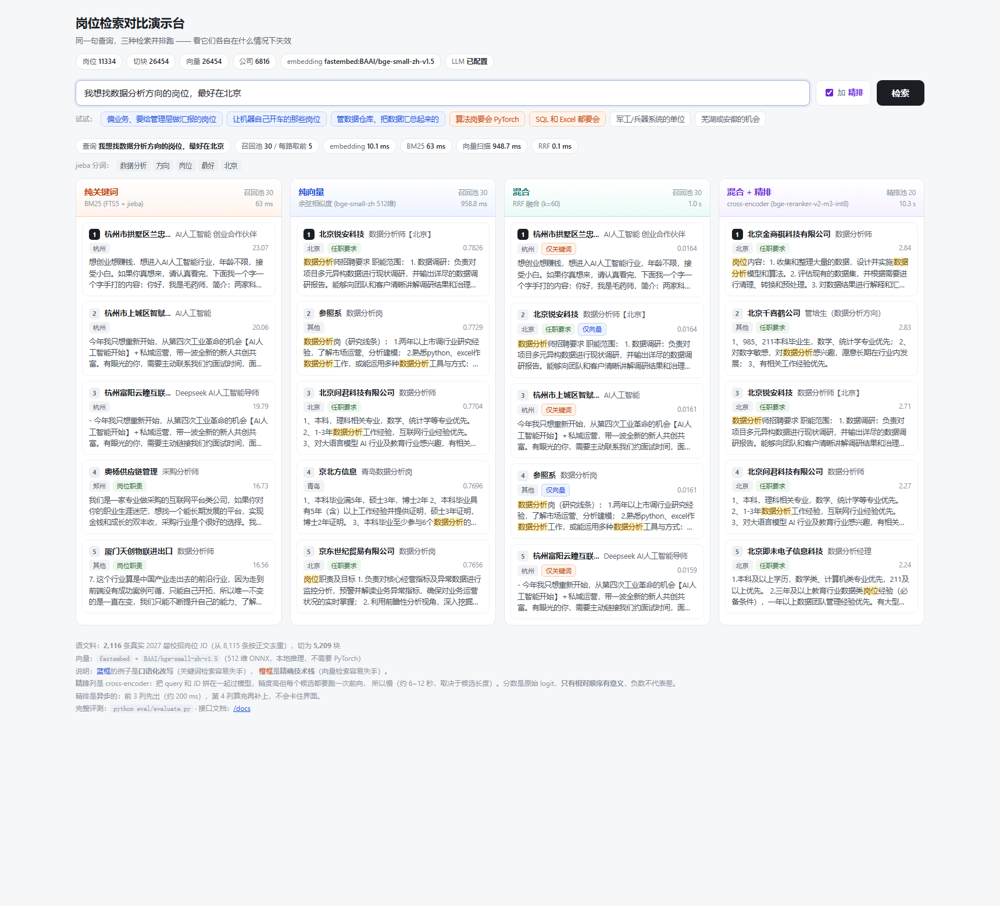

# RAG 岗位智能问答系统

> 面向秋招场景的岗位语义检索系统：把真实校招岗位 JD 灌入检索库，
> 支持"找数据分析方向、能接受非大厂、在江浙沪"这类**语义化查询**，
> 关键词检索做不到的事由 RAG 补上。

**当前状态**：✅ **端到端可用**（真实语料 + 真实 embedding + 评测 + 生成 + HTTP 服务）

| 环节 | 现状 |
|---|---|
| **语料** | **11,334 条**真实中文岗位 JD，来自两个来源（校招 2,116 + 社招 9,218，跨来源零重复） |
| **方向** | 数据分析 2,509 / 经济金融 1,808 / 算法岗 1,793 / 生物统计 1,639 / 大模型相关 1,469（数据集自带人工分类） |
| **切块** | 26,454 块，按 JD 语义段（岗位职责 / 任职要求 / 加分项 / 福利待遇 / 公司介绍） |
| **向量** | `fastembed` + `BAAI/bge-small-zh-v1.5`（**512 维 ONNX，不需要 PyTorch**） |
| **检索** | BM25 关键词 + 向量余弦 + RRF 融合，**+ cross-encoder 精排**（两阶段检索） |
| **评测** | 50 条查询 + 规则化标注，**Precision@5 / MRR / Hit@5**，含精排池消融 |
| **生成** | 检索 Top-K → DeepSeek 生成**带引用编号**的答案（拒绝编造） |
| **演示页** | `GET /` 四路检索并排对比 + 命中词高亮（渐进式：三列先出，精排算完补上） |
| **服务** | FastAPI：`GET /compare`、`GET /search`、`POST /ask`、`GET /health` |



> 同一句查询、四路并排跑。这张图里**纯关键词返回的是"杭州 AI 人工智能创业合作伙伴"**
> （城市错、方向错），而**混合+精排的 5 条全是"北京 + 数据分析"**。
> 演示页的价值就是把这种差别变得肉眼可见。

---

## 一、为什么做这个

关键词检索（`LIKE '%数据分析%'`）解决不了这些真实查询：

| 用户会这么问 | 关键词检索 | RAG |
|---|---|---|
| "找偏业务的数据分析，要给管理层做报表" | ❌ 匹配不到"Business Analyst" | ✅ 语义相近 |
| "想做 RAG 知识库，有向量检索经验的岗位" | ❌ JD 里写的是"检索增强生成""向量数据库" | ✅ 同义理解 |
| "大专以上能做的、会 SQL 和 Excel 就行的数据岗" | ⚠️ 只能匹配字面词 | ✅ 理解条件语义 |

---

## 二、评测结果（**真实数据，199 条查询**）

### 评测集怎么来的（**两部分，质量不一样，得分开说**）

| 部分 | 条数 | 怎么来的 | 优缺点 |
|---|---|---|---|
| **手写** | 50 | 我按"真人会怎么问"逐条写 | 提问自然、有口语化改写；但样本少 |
| **模板生成** | 149 | 用**方向标签 × 城市/学历/技术栈/薪资** 等维度组合 | **标注客观**（用的是数据集自带的人工分类标签）；但提问方式不如手写自然 |
| **合计** | **199** | | |

**为什么非要扩到 199 条**：50 条时 Hit@5 每变 1 条就是 **0.02**，
池子消融那几个点的差异**全在噪声里**，得不出任何结论。
扩到 199 条后单条权重降到 **0.005**，方向性趋势才可信。

> **诚实标注**：下面所有数字，都在 199 条上跑。
> 但**不要把"199 条"当成"199 条高质量人工标注"**——其中 149 条是模板生成的，
> 标注客观但提问单一。这是"为了降低噪声"付出的代价，我认。

相关性判定用**规则化标注**（按方向标签/岗位标题/公司/城市/JD 正文），
见 `eval/build_eval_set.py`。语料 **11,334 条岗位**（两个来源合并）。

**五种模式，召回池统一为 30**（统一池子很重要，否则"加了精排所以更好"可能只是
因为那条路召回了更多候选，而不是精排的功劳）：

| 模式 | Hit@5 | **Precision@5** | **MRR** | Recall@5 | 平均延迟 |
|---|---|---|---|---|---|
| 纯关键词 | 0.633 | 0.385 | 0.475 | 0.027 | **50.3 ms** |
| 纯向量 | 0.809 | **0.502** | 0.648 | 0.026 | 1113.1 ms |
| 混合（RRF） | 0.829 | 0.465 | 0.655 | 0.030 | 651.9 ms |
| **混合 + 精排** | **0.854** | **0.618** | **0.755** | 0.032 | 7170.1 ms |

> 精排一列是**实际部署的配置**：候选池 30、送入精排的文本**截断到 200 字**
> （这个参数的定标见下面「怎么把精排的延迟压下去」）。
> 未截断时是 Precision@5 0.627 / MRR 0.734 / 12948 ms —— 精度几乎一样，但慢一倍。

> ### ⚠️ 评测集扩大后，有个结论**翻转了**，必须说清楚
>
> **50 条查询**时，混合的 Precision@5 **高于**纯向量（0.500 vs 0.468），
> 我当时写的是"混合在精度上也更优"。
>
> **扩到 199 条后，反过来了**：混合 **0.465**，纯向量 **0.502**。
>
> 也就是说，原来那个结论**是 50 条样本的噪声，站不住**。
> 这正是我扩评测集的原因——**在小样本上得出的结论，很可能只是拟合噪声**。
>
> **现在（199 条上）能站住的结论只有两条**：
>
> 1. **混合相对纯向量只有微弱优势，而且在 Precision@5 上并不占优**
>    （Hit@5 0.829 vs 0.809、MRR 0.655 vs 0.648，差距都很小）；
> 2. **真正稳定、大幅的提升来自 cross-encoder 精排**：
>    Precision@5 **0.465 → 0.618（+33%）**、MRR **0.655 → 0.755**。
>    这个提升在**绝大多分类**上都成立，两批语料上也都成立。
>
> 我宁可写"混合的优势我没测出来"，也不写一句样本量不支持的话。

> **语料扩大后的绝对值也会下降，这是对的**：语料从 2,116 涨到 11,334（5.4 倍干扰项），
> 任务变难，绝对值自然回落。**在更大的语料和更大的评测集上做评测，
> 比在小样本上刷高分诚实得多。**

> **为什么主指标是 Precision@5 / MRR，而不是 Recall@5**
> 找岗位这类任务，**相关集天然很大**——"北京的算法岗"几百上千条都算相关。
> 此时 Recall@5 的上限只有 5/几百 ≈ 0.01，任何方法都接近 0，**指标失去区分度**。
> 求职者真正关心的是"第一屏准不准"和"最相关的排多前"，所以用 Precision@5 和 MRR。

### 分类拆解：每种方法各自在哪里失效

Precision@5（**加粗 = 该行最好**）：

| 查询类型 | n | 纯关键词 | 纯向量 | 混合 | 混合+精排 |
|---|---|---|---|---|---|
| **术语类**（精确技术栈名） | 12 | 0.683 | **0.267** | 0.533 | **0.900** |
| **改写类**（口语化，不含术语） | 12 | **0.350** | 0.333 | 0.433 | **0.517** |
| **方向类**（数据分析/大模型/金融…） | 8 | 0.550 | **0.775** | 0.625 | 0.700 |
| 条件类（学历/专业/语言） | 6 | 0.300 | 0.467 | 0.333 | **0.567** |
| 对照类（窄方向） | 17 | 0.694 | 0.694 | **0.788** | 0.729 |
| 城市类 | 4 | 0.200 | 0.550 | 0.400 | **0.450** |
| 公司类 | 4 | 0.050 | 0.300 | 0.250 | **0.400** |
| 生成·方向城市 | 30 | 0.040 | 0.413 | 0.240 | **0.467** |
| 生成·方向技术 | 20 | 0.550 | 0.360 | 0.390 | **0.800** |
| 生成·方向条件 | 15 | 0.160 | **0.240** | 0.200 | **0.293** |
| 生成·方向薪资 | 15 | 0.093 | **0.267** | 0.187 | 0.160 |
| 生成·改写 | 20 | 0.230 | **0.680** | 0.500 | **0.680** |
| 生成·公司 | 24 | 0.892 | 0.825 | 0.883 | **0.942** |
| 生成·城市 | 11 | 0.200 | 0.618 | 0.455 | **0.655** |

**这张表才是整个项目最值钱的东西**——它说明**没有一种方法全面更好**：

1. **纯关键词在"方向类"几乎失效**（生成·方向城市 **0.040**）：用户问
   "数据分析方向、北京的岗位"，BM25 会把含"数据""分析"字样的无关岗位全拉上来。
2. **纯向量在精确术语上塌方**（0.267）：查"要会 PyTorch"，向量把语义相近但
   技术栈不同的岗位排上来（实测有岗位片段里写的是 `PaddleNLP / TensorRT`，
   **根本没有 PyTorch**）。
3. **纯向量在宽方向查询上最强**（方向类 0.775、生成·改写 0.680）：
   没有具体关键词可匹配时，语义向量天然占优。
4. **纯关键词在公司/窄方向上最强**（生成·公司 0.892、对照类 0.694）：
   这类查询本质就是**实体匹配**，字面命中就是最优解。
5. **精排把"塌方的地方"修得最狠**：术语类 0.533 → **0.900**、
   方向技术 0.390 → **0.800**（+105%）、方向城市 0.240 → **0.467**（+95%）。
   原因很直接——cross-encoder 把 query 和 JD **拼在一起**过模型，
   注意力可以跨两者交互，既懂"口语描述"又认得"精确术语"。
6. **但精排在"纯向量已经很强"的地方反而没提升**（生成·改写 0.680 → 0.680，
   方向薪资 0.267 → 0.160 还降了）。**精排不是万能的**，
   它擅长的是"把字面和语义两路的分歧判清楚"。
7. **代价是慢 140 倍**（50 ms → 7.2 s）。怎么压下去见下一节。

### 怎么把精排的延迟压下去

精排精度最好但慢得不能交互使用。能动的杠杆有三个：

| 杠杆 | 效果 |
|---|---|
| **截断送入精排的文本长度** | ★ 约 **2 倍**加速，精度几乎不掉 |
| 缩小候选池 | 省延迟，但**精度代价大得多** |
| 换更小的重排模型 | 要重下 1 GB，且换模型后全部基线作废 |

**三处独立测量，结论一致：截断到 200 字约快 2 倍。**

`eval/rerank_budget.py` 把网格跑了一遍（40 条查询抽样，**逐条查询交错测所有配置**）：

| 候选池 | 文本截断 | Hit@5 | Precision@5 | MRR | 精排耗时 | 总耗时 |
|---|---|---|---|---|---|---|
| 30 | 不截断 | 0.850 | **0.606** | 0.730 | 13 516 ms | 14.2 s |
| **30** | **200 字** | 0.825 | 0.576 | 0.706 | **6 457 ms** | **7.2 s** ← 采用 |
| 20 | 200 字 | 0.825 | 0.573 | **0.720** | 4 565 ms | 5.3 s |
| 10 | 200 字 | 0.825 | 0.543 | **0.734** | 2 521 ms | 3.2 s |
| 10 | 300 字 | 0.850 | 0.562 | 0.748 | 3 265 ms | 4.0 s |

隔离直测（10 条查询，只计精排那一小段）：

| 截断 | 池内实际均长 | 精排耗时 | 相对 |
|---|---|---|---|
| 不截断 | 272 字 | 18 251 ms | 1.00x |
| 300 字 | 223 字 | 12 652 ms | 1.44x |
| **200 字** | **173 字** | **8 927 ms** | **2.04x** |
| 150 字 | 137 字 | 7 258 ms | 2.51x |

端到端评测（199 条查询）也吻合：**12 948 ms → 7 170 ms**，
扣掉召回那约 1.1 秒，精排本身是 **1.96 倍**加速。

**HTTP 服务上的实测**（`/compare?rerank=1`，3 条查询取均值，机器空闲）：

| `rerank_pool` | 精排耗时 |
|---|---|
| 30 | 3.1 s |
| **20（演示页默认）** | **2.1 s** |
| 15 | 1.9 s |
| 10 | 1.4 s |

> ⚠️ **延迟受机器负载影响很大，别只看一个数**。
> 同一份代码、同一个查询，我在不同的机器状态下测到过 **2.0 秒**和 **9.9 秒**。
> 上表是在机器空闲时、每条查询之间留了间隔测的，重复 3 次方差很小（2.0/2.2/2.0）。
> 前面那个 9.9 秒的读数旁边有别的进程在抢 CPU。
> **报延迟数据必须说明测试条件**，否则数字没有意义。

**结论：该动的是"输入长度"，不是"候选数量"。**

- 截断到 200 字：Precision@5 掉 **0.030**，精排快 **2.1 倍**；
- 把候选池从 30 缩到 10：Precision@5 掉 **0.063**（两倍代价），只再快 2.5 倍。

> **为什么截断几乎不掉精度、MRR 有时还升**：切块开头就是「公司 · 岗位」+ 段落名
> + 核心要求，尾部常是流程性套话。截断相当于**去噪**，
> 让 cross-encoder 的注意力集中在真正有判别力的内容上。

> #### ⚠️ 这里我第一版测错了，写清楚免得别人再踩
>
> 我写的第一个预算脚本是**"外层循环配置"**——把最慢的"不截断"那组先整个跑完，
> 再跑截断组。结果测出"截断省 **85%** 时间、总耗时 14.7 s → 2.9 s"。
>
> 但这个数和另外两处对不上：端到端评测是 45%（精排部分 1.96x），
> 单独隔离测是 **2.04x**。**两处独立测量互相吻合，只有那一组是异类。**
>
> 原因是**顺序偏差**：最慢那组先跑，把 CPU 状态（缓存、频率）带偏了，
> 后面几组是在**不同的机器状态**下测的。改成**逐条查询交错测**之后，
> 数字变成 2.09x，和三处全部对上。
>
> **教训**：做性能对比时，**千万别一个配置跑完再跑下一个**。
> 而且——**当几个测量互相矛盾时，别挑对自己有利的那个用**，
> 要再测一次来裁决。

> #### 另一个被证伪的思路（也记在这里，免得以后重复踩）
>
> 我原本想的是「**两路召回一致时就跳过精排**」——BM25 和向量都指向同一批结果时，
> 说明查询不难，没必要花十几秒精排。
>
> 于是实现了 `channel_agreement`（两路 top-5 的 Jaccard）+ 阈值，
> 在 199 条评测集上跑了一遍，结果：
>
> ```
> 自适应精排（阈值 0.50）：199 条查询里跳过了 0 条（0%）
> ```
>
> 回头量了一下一致度分布：**中位数 0.000，最高只有 0.429**。
> 也就是说，绝大多数查询下 **BM25 的 top-5 和向量的 top-5
> 连一个重合的岗位都没有**——这个信号压根不存在，阈值定多少都跳不过去。
>
> 第一版还犯了个更基础的错：一开始按 **chunk** 算一致度。但两路经常命中
> **同一岗位的不同切块**（BM25 命中「岗位职责」那块、向量命中「任职要求」那块），
> chunk 层看完全不同、岗位层其实是同一个。改成岗位级之后数值才正常。
>
> **结论：这个启发式被证伪，代码留在 `eval/calibrate_adaptive.py` 里当记录。**
> 与其留一个看起来聪明但实测没用的机制，不如删掉并写清楚为什么不行。


### 诚实的边角

- **公司类查询四种方法都弱**（0.25~0.40）：公司名不在 JD 正文语义里，
  embedding 学不到，"字节跳动"和"数据分析"之间没有语义关联。
  要修得靠一层**公司别名词典**做结构化过滤，不是换模型能解决的。
- **相关标注是规则化的**，规则偏向字面匹配，对关键词检索略有利。

**这个"每种方法各自在什么情况下失效、代价多少、池子取多大"的拆解，
比一个笼统的提升数字有价值得多。**

### 可视化：检索对比演示台（`GET /`）

上面这些表是**数字**，演示台是**任你亲眼验证**：

```
输入一句查询 → 四列并排跑 → 每列显示自己的分数、耗时、命中词高亮
```

**为什么做"对比"而不是"聊天窗口"**：项目的差异化就是"两种检索各自的失效点"。
聊天窗口会把这个藏起来；三列并排，面试官 10 秒就懂。

实测两个方向（都能在页面上点出来）：

| 查询 | 纯关键词 | 纯向量 |
|---|---|---|
| `偏业务、经常要给管理层做汇报的岗位` | 前 5 条**只有 1 条相关**（第 2、3 名是"大模型Agent算法工程师"） | **5 条全相关** |
| `算法岗要会 PyTorch` | 命中片段里能看到 **PyTorch** 高亮 | 第 4 名"NLP算法工程师"片段里是 `PaddleNLP / TensorRT`，**根本没有 PyTorch** |

**命中词高亮**是关键：它把 jieba 分词结果标在原文上，
于是"关键词为什么命中 / 为什么没命中"从猜测变成**可以直接看**。
（顺带也暴露了 jieba 的真实缺陷——查「算法岗要会 PyTorch」它切成 `算法 / 岗要 / PyTorch`，
`岗要` 不是词。这种不完美也照实显示，不粉饰。）

接口是 `GET /compare`，一次调用返回三路 + 各项耗时分解 + 分词结果。

---

## 三、架构

```
                  ┌─────────────────────────────┐
   岗位 JD 数据 ──▶│  chunking.py  按语义段切块    │
                  │  （职责/要求/加分项，非固定字数）│
                  └──────────────┬──────────────┘
                                 │
                  ┌──────────────▼──────────────┐
                  │  schema.py    SQLite 存储     │
                  │  ├ documents  岗位原文        │
                  │  ├ chunks     切块 + 预留向量列 │
                  │  └ chunks_fts FTS5 分词索引    │
                  └──────────────┬──────────────┘
                                 │
        ┌────────────────────────┼────────────────────────┐
        │                        │                        │
┌───────▼────────┐   ┌───────────▼──────────┐   ┌─────────▼────────┐
│ keyword_search │   │   vector_search      │   │  eval/evaluate   │
│ BM25 (FTS5)    │   │  余弦相似度 (numpy)    │   │  Recall/MRR 评测  │
└───────┬────────┘   └───────────┬──────────┘   └──────────────────┘
        │                        │
        └───────────┬────────────┘
                    │
          ┌─────────▼─────────┐
          │  rrf_fuse  RRF融合 │
          └─────────┬─────────┘
                    │
              Top-K 岗位结果
```

**为什么用 RRF 而不是加权求和**：BM25 分数与余弦相似度量纲完全不同，
直接加权需要反复调参；RRF 只依赖**排名**，无需归一化，通常更稳。

---

## 四、目录结构

```
rag-job-qa/
├── src/
│   ├── schema.py            数据层：表结构、jieba 分词、FTS5 索引维护与重置
│   ├── chunking.py          切块：按 JD 语义段（支持"段名独立成行"与"行内加冒号"两种写法）
│   ├── embeddings.py        向量化接口：hash(占位) / fastembed(ONNX) / st / api
│   ├── retrieval.py         检索：BM25 / 向量余弦 / RRF 融合 / 两阶段(召回+精排)
│   ├── rerank.py            ★ cross-encoder 精排（bge-reranker-v2-m3-int8）
│   ├── ingest.py            入库（两阶段：先入库、后批量向量化）
│   ├── generate.py          ★ 端到端问答：检索 Top-K → DeepSeek 生成带引用的答案
│   ├── api.py               ★ FastAPI 服务：/ . /compare . /search . /ask . /health
│   └── export_recruitops.py 真实语料导出：从 pg_dump 备份离线解出岗位 JD
│   └── fetch_external_jds.py  ★ 下载开源招聘数据集（走镜像，因为 github.com 连不上）
│   └── import_external_jds.py ★ 转换开源数据集并与本机语料合并
│   └── label_documents.py     ★ 给缺少方向标签的岗位补 label（保持全库一致）
├── web/
│   └── index.html           ★ 检索对比演示台（单文件、零构建、零依赖）
├── eval/
│   ├── build_eval_set.py    ★ 生成 50 条评测集（规则化标注）
│   ├── evaluate.py          评测：Precision@k / MRR / Hit@k，三模式 + 分类拆解
│   ├── eval_set.json        评测集（脚本产出）
│   └── latest_results.json  最近一次评测结果
├── tests/
│   ├── smoke_test.py        全链路自测（17 项断言，用隔离临时库）
│   ├── check_embedder.py    ★ 验证 embedding 的语义能力（相近词 vs 无关词）
│   ├── check_chunking_real.py ★ 用真实语料检查切块质量
│   ├── debug_split.py       切块调试工具
│   ├── verify_export.py     导出语料核验（乱码/HTML/重复/长度分布）
│   └── analyze_corpus.py    语料质量分析（去重、公司/方向分布）
├── docs/
│   ├── export_verify.txt    语料核验报告（脚本产出）
│   └── corpus_analysis.txt  语料分析报告（脚本产出）
├── data/
│   ├── sample_jobs.json        示例岗位（10 条，仅供自测）
│   ├── prod_jobs.json          真实岗位全量（8,115 条，18.4 MB）
│   ├── prod_jobs.dedup.json    真实岗位去重版（2,116 条，4.6 MB）← 入库用这个
│   └── rag.db                  SQLite：2,116 岗位 / 5,209 切块 / 全部 512 维向量
└── requirements.txt
```

---

## 五、快速开始

### 一键运行（推荐）

**Windows**：双击 `启动.bat`。没有数据库时会先问你要不要建库（约 25 分钟，会下载约 200 MB 模型）。

**任意平台**：

```bash
python setup.py all      # 建 venv + 装依赖 + 下模型 + 拉数据 + 建库（约 25 分钟）
python setup.py serve    # 启动，然后打开 http://127.0.0.1:8000
```

`setup.py` 只用标准库，随便哪个 Python 都能把它跑起来；
每一步都会先检查产物在不在，**可以反复跑、失败后接着跑**。

```bash
python setup.py check    # 只读自检：环境/依赖/数据/库 都到位了吗
```

> **pip 源会自动回退**（清华 → 阿里云 → 中科大 → 官方）。
> 实测清华镜像会偶发抽风，而它失败时报的是
> `No matching distribution found`——**看起来像包不存在或 Python 版本不支持，
> 完全看不出是镜像的问题**，所以一键脚本必须能换源重试。

### 手动分步（想看每一步在做什么）

```bash
python setup.py venv                 # 1. venv + 依赖
python setup.py models               # 2. 下载 embedding / 精排模型
.venv/Scripts/python.exe tests/check_embedder.py   #    验证向量真有语义能力
python setup.py data                 # 3. 拉开源数据集并转换合并
.venv/Scripts/python.exe tests/check_chunking_real.py  # 验证切块质量
python setup.py ingest               # 4. 建库（约 25 分钟）
.venv/Scripts/python.exe tests/smoke_test.py           # 全链路自测（应 17/17）
python setup.py serve                # 5. 启动
```

跑评测：

```bash
.venv/Scripts/python.exe eval/build_eval_set.py
.venv/Scripts/python.exe src/rerank.py --selftest     # 先验证重排模型有效
.venv/Scripts/python.exe eval/evaluate.py --embed fastembed \
    --modes keyword vector hybrid rerank
# 精排池消融
.venv/Scripts/python.exe eval/evaluate.py --modes rerank --rerank-pool 10
```

命令行问答（不用起服务）：

```bash
set DEEPSEEK_API_KEY=sk-xxx
.venv/Scripts/python.exe src/generate.py --query "找偏业务的数据分析岗，要给管理层做报表"
```

### ⚠️ 可复现性边界（重要，别被绕进去）

| 语料来源 | 条数 | 别人克隆后能否拿到 |
|---|---|---|
| 开源数据集（Boss直聘/智联/猎聘） | 9,218 | ✅ `setup.py data` 自动下载 |
| 本机 RecruitOps 的 pg_dump 备份 | 2,116 | ❌ **依赖作者本机安装的软件**，别人跑不了 |
| **合计（作者实测用的语料）** | **11,334** | — |

**所以**：

- **README 里的评测数字是在 11,334 条上跑的**（作者的完整语料）；
- 你克隆后 `setup.py all` 得到的是 **9,218 条**（公开数据集），
  数字会有差异——语料小了，干扰项少，通常还会**偏高一点**；
- 流水线本身是**确定性的**（固定随机种子、无采样），
  同一份语料重跑两次结果一致。

**为什么仓库里不放数据**：`rag.db` 是 137 MB 的构建产物（别人能重建）；
第三方 xlsx **原仓库没有 LICENSE**，不该由本仓库再分发；
本机导出的那部分更是别人的机器上不存在。详见 `.gitignore` 里的说明。

> **注意**：换 embedding 模型必须 `--reset` 重新入库，否则新旧向量维度不一致
> （hash 占位实现是 256 维，bge-small-zh-v1.5 是 **512 维**）。

---

## 六、关键技术决策（面试会问）

### 1. 为什么不用纯向量，而用混合检索？

- **纯向量**：语义泛化好，但对**精确术语**（版本号、技术栈名、公司名）容易失手
- **纯关键词**：精确，但无法处理同义表达
- **混合 + RRF**：两者互补。RRF 只用排名，避免分数归一化的调参地狱

### 2. 为什么切块要按语义段，而不是固定字数？

岗位 JD 天然分段（岗位职责 / 任职要求 / 加分项）。
若按 500 字硬切，会把"任职要求"从中间切断，
检索出的块**语义残缺**，生成答案时也缺关键条件。

实测对比（本项目 `tests/smoke_test.py` 覆盖）：

| 切法 | 结果 |
|---|---|
| 固定字数 | 3 个语义段被混成 1 块 |
| **按语义段** | 3 块，`岗位职责` / `任职要求` / `加分项` 各自独立 |

### 3. 中文分词的坑

SQLite 内置 `unicode61` 分词器**对中文几乎无用**——实测把整句
`数据分析工程师，负责用户分层` 当成 **2 个词条**，`MATCH '数据分析'` 命中 **0 条**。

解决方案：
- 用 `jieba` 分词，**分词结果单独存一张 FTS5 表**（原文与索引分离）
- 领域词（`数据分析师`、`向量数据库`、`pgvector`…）用**长度降序的多模式匹配加保护符**，
  防止被 jieba 切碎（`jieba.add_word` 不保证更长优先，实测无效）

### 4. 为什么向量列先放 SQLite 而不是直接用 pgvector？

先跑通链路、验证评测框架，再迁移存储。`chunks.embedding` 已预留为 BLOB，
迁移到 PostgreSQL 时改为 `vector(N)` 并用 `<=>` 检索即可，**其余代码不动**。

**实测结论**：2,116 岗位 / 5,209 切块的规模，SQLite 单次向量检索约 240 ms，
完全够用。**到十万级再迁 pgvector**，现在迁是过度工程。

### 5. 切块：真实语料暴露的两个 bug（都值得讲）

自测用**带冒号**的示例 JD（`岗位职责：… 任职要求：…`）一直是 17/17 通过，
换成真实语料后平均只有 **1.13 块/岗位**——分段检索这个核心价值完全没生效。

**根因**：真实 JD 的段名**独立成行、不带冒号**：
```
岗位职责
1、负责电机驱动器控制算法…
任职要求
1、硕士及以上…
```
而当时的分块正则要求段名后面必须有冒号。

修完之后又暴露第二个问题：**合并发生在切分之后，没有重新检查长度，也没继承段名**——
JD 开头的无段名总述会把紧跟的「岗位职责」整段吸走，导致这一块段名丢失；
同时 490/4513 个块超过了 480 字上限。

两次修复后：**平均 2.46 块/岗位、超长块 0、段名丢失 0**。

> **教训**：自测数据必须覆盖真实数据的**格式分布**，否则测试全绿也没用。
> 现在 `tests/check_chunking_real.py` 直接用真实语料检查，不再只靠示例数据。

### 6. 入库时的两个 bug（**藏得极深，值得单独讲**）

往语料里加了第二个数据源之后，入库跑到一半崩了：

```
sqlite3.OperationalError: cannot DELETE from contentless fts5 table: chunks_fts
```

看起来是 FTS 的问题，**但真正的原因有两个，而且第二个才是根因**。

**Bug A：`contentless_delete=1` 没开**

`chunks_fts` 是 contentless 表（`content=''`），默认**不允许 DELETE**。
而 `insert_chunk` 需要"先删同 rowid 再插"来支持重复插入。

这个 bug 隐蔽在于**它的行为取决于 rowid 存不存在**（实测）：

| DELETE 的目标 | `content=''` | `content='', contentless_delete=1` |
|---|---|---|
| rowid **不存在** | 成功（SQLite 直接跳过） | 成功 |
| rowid **存在** | **报错** | 成功 |

而代码里 DELETE 总在 INSERT **之前**执行，所以**全新入库时那个 rowid 永远还不存在**——
前两次全量入库（2,116 条、5,209 块）都是绿的，问题一直没暴露。

**Bug B（根因）：`doc_key` 撞了**

那我给新数据集用的键是 `ext|公司|岗位|城市`。
同一个公司、同一个岗位名、同一个城市，会有**多条不同的招聘帖**——
它们的 `doc_key` 完全相同，`insert_document` 的 `ON CONFLICT DO UPDATE`
把不同岗位**静默合并成了一个文档**；
合并后同一 `(doc_id, chunk_index)` 会被插第二次，这才触发了 Bug A。

**两处修复**：

1. `chunks_fts` 加上 `contentless_delete=1`（SQLite ≥ 3.43），
   并在 `init_db` 里加了**迁移检测**——老库缺这个选项就自动重建索引
2. `doc_key` 拼上正文哈希（`ext|公司|岗位|城市|sha1[:8]`）保证唯一；
   同时在 `ingest.py` 开头加了 **doc_key 唯一性预检**，重复就直接报错退出，
   不再让它跑到一半才崩

> **教训**：报错信息指向的地方（FTS）往往不是根因。
> "静默合并"这类失败最危险——**它不报错，只是悄悄少了几千条数据**。
> 现在 `import_external_jds.py` 和 `ingest.py` 都会在开头做唯一性自检。

### 7. pip 镜像会偶发抽风，而报错完全误导

我把自己做的"一键运行"克隆到干净目录测，`setup.py venv` 直接失败：

```
ERROR: Could not find a version that satisfies the requirement jieba>=0.42.1
ERROR: No matching distribution found for jieba>=0.42.1
```

这句话看起来是"**jieba 这个包不存在**"或者"**Python 版本不支持**"。
当时系统 Python 是 3.14，我一度以为是缺 cp314 的 wheel。

**实际都不是。** 逐个包试装，7 个包**全部**报同样的错——
真是版本问题不可能那么整齐。查下去发现：

- 清华镜像的索引页**本身可达**（HTTP 200，60 KB）；
- 用 pip **25.0.1** 走同一个镜像**成功**，pip **26.1.2** 失败；
- 但几分钟后，pip 26.1.2 走清华、阿里云、中科大、官方源**全部成功**。

**结论：镜像偶发抽风**，pip 把索引拉取失败报成了"找不到包"。

**修复**：`setup.py` 改成**逐源回退**（清华 → 阿里云 → 中科大 → 官方），
并加 `--retries 2 --timeout 30` 让坏源尽快暴露，而不是卡十分钟。

> **教训**：报错信息会把人带到完全错误的方向。
> 「所有包都报同一种错」＝**先怀疑源/网络，别怀疑包**。
> 另外，**一键脚本必须有回退**——否则使用者会卡在一个看不懂的错误上，直接放弃。

---

## 七、当前局限（诚实说明）

| 局限 | 影响 | 怎么解决 |
|---|---|---|
| **语料方向偏斜** | 去重后 83.6% 是算法/AI 岗，**数据分析岗只占 5.8%（122 条）** | 见下方「语料偏差」小节 |
| **相关标注是规则化的** | 规则偏向字面匹配，对关键词检索略有利；不是逐条人工标注 | 抽样人工复核；或扩到 200 条后人工标注 |
| **语料只有 2,116 条** | 比真实招聘平台小几个数量级，只够验证方法 | 接更多来源 |
| 公司类查询表现弱 | Precision@5 只有 0.25–0.40（**四种方法都弱**） | 公司名不在 JD 语义里，embedding 学不到；得加一层公司别名词典做结构化过滤 |
| embedding 模型较小 | bge-small-zh 只有 512 维，对英文缩写（RAG/pgvector）区分力弱 | 换 bge-base-zh 或加领域微调 |
| **精排慢（5.7 s）** | CPU 跑 cross-encoder，无法用于交互式首屏 | 见下方「精排延迟怎么办」 |

> ⚠️ **评测数字可以用，但必须带上口径**：50 条查询、规则化标注、召回池 30、Precision@5。
> 可以说"混合+精排把 Precision@5 从 0.496 提到 0.744"；
> **不能说**"召回率提升 X%"——相关集中位数 109 条，Recall@5 本来就接近 0。

### 精排延迟怎么办（还没做，方向明确）

5.7 秒对"求职者实时搜岗位"不可接受。可行做法按性价比排：

1. **只对难查询精排**（最推荐）：如果 BM25 与向量的 top-5 高度重合，说明两路一致、
   不必精排；只有两路分歧大时才触发。平均延迟可压到 1 秒级。
2. **异步两段返回**：先立刻返回混合结果，精排算完再补一次——演示页现在就是这么做的。
3. **换更小的重排模型**：`bge-reranker-base`（278M，约一半算力），精度会掉，需实测。
4. **上 GPU / 更低比特量化**：本机只有 `CPUExecutionProvider`，上 GPU 最直接。

> 这些**都要用同一套 50 条评测集验证**，不能凭感觉说"更快了"。

### 语料偏差（必须知道，否则结论会误导）

**合并前的来源一**（本机 RecruitOps 导出，2,116 条）方向分布严重偏斜：

| 方向 | 条数 | 占比 |
|---|---|---|
| 算法 / AI | 1,770 | **83.6%** |
| 开发 / 工程 | 320 | 15.1% |
| **数据分析 / 商业分析** | **122** | **5.8%** |
| 硬件 / 制造 | 23 | 1.1% |

**这正是要补来源二的原因**——只有 122 条数据分析岗，
任何"数据分析岗都在要求什么"的结论都不可靠。

**合并后**（11,334 条）：

| 方向标签 | 条数 | 占比 | 来源 |
|---|---|---|---|
| **数据分析** | 2,509 | 22.1% | 数据集自带 |
| （无标签，来源一） | 2,116 | 18.7% | 待 `label_documents.py` 补齐 |
| 经济金融 | 1,808 | 16.0% | 数据集自带 |
| 算法岗 | 1,793 | 15.8% | 数据集自带 |
| 生物统计 | 1,639 | 14.5% | 数据集自带 |
| 大模型相关 | 1,469 | 13.0% | 数据集自带 |

**仍然要注意的偏差**：

- **校招 : 社招 ≈ 1 : 4.4**（来源一是 2027 届校招，来源二带薪资、基本是社招）。
  两者用 `job_type` 区分，做"校招岗位分析"时必须过滤。
- **来源一仍高度集中于字节系**（占其 25.9%）。
- **城市分布偏一线**：北京 3,103、上海 1,065、深圳 779、广州 763，
  而求职者所在山东的岗位很少——**这个偏差对"帮我找山东的岗位"类查询是不利的**，
  实测也确实检索不出多少山东岗位（不是检索的问题，是语料里就没有）。

---

## 八、下一步计划

- [x] **接入真实数据**：从 RecruitOps 的 pg_dump 备份离线导出（8,115 条 → 去重 2,116 条）
- [x] **真实语料入库**：2,116 岗位 / 5,209 切块
- [x] **换真实 embedding**：`fastembed` + `BAAI/bge-small-zh-v1.5`（512 维 ONNX，**不需要 PyTorch**）
- [x] **切块逻辑修复**：支持"段名独立成行"（真实语料主流写法），平均 1.13 → 2.46 块/岗位
- [x] **评测集扩到 50 条**：规则化标注 + 6 类查询
- [x] **重跑评测**：Precision@5 / MRR / Hit@5 三路对比 + 分类拆解
- [x] **接入生成**：检索 Top-K → DeepSeek，**带引用编号、拒绝编造**
- [x] **FastAPI 服务**：`/health` `/search` `/ask` `/compare`
- [x] **检索对比演示台**：四列并排 + 命中词高亮（单文件 HTML，零依赖，渐进式加载）
- [x] **加 rerank**：cross-encoder 精排，Precision@5 0.496 → **0.744**，并做了池子消融
- [ ] **一键运行**：`docker compose up` 或 `.bat`，让别人能自己跑起来
- [ ] **公司别名词典**：公司类查询四种方法都只有 0.25~0.40，得靠结构化过滤补
- [ ] **迁移 pgvector**（可选）：数据量到十万级再说，现在 SQLite 完全够用
- [ ] **开源到 GitHub**：README + 评测结果表 + 演示页截图已就绪

> **环境提醒**（都是实测踩出来的）：
> - pip 用清华镜像（默认源卡 19 分钟，镜像 30 秒）
> - 下载 HF 模型必须 `HF_ENDPOINT=https://hf-mirror.com` + `HF_HUB_DISABLE_XET=1`
>   （Xet 后端走 `cas-server.xethub.hf.co`，镜像不代理，会 401）
> - 调 Python 一律加 `-B`，避免生成 `__pycache__`

---

## 九、数据来源说明

语料由**两个来源**合并而成（共 11,334 条，跨来源零重复）。

### 来源一：本机 RecruitOps 导出（校招，2,116 条）

从 RecruitOps 的数据库备份里离线导出

RecruitOps 秋招工作台把岗位存在它自带的 PostgreSQL 里，但**连不上**：

- 服务已停（2026-10-07 因 startup process failure 关闭）
- `pg_hba.conf` 全部 `scram-sha-256`
- 密码在 `instance.json` 里是 **DPAPI 加密**的，无法解密

**绕过办法**：它每次 schema 迁移前会 `pg_dump` 一份备份到 `backups/*.dump`，
这是标准自定义格式，用**它自带的 `pg_restore`** 就能解出 `COPY` 文本，
**不需要起数据库、不需要密码**：

```bash
D:\RecruitOps\resources\desktop-runtime\postgres\bin\pg_restore.exe \
  --data-only -t job_snapshots --no-owner --no-privileges -f out.sql <dump>
```

`src/export_recruitops.py` 把上面的步骤 + COPY 反转义 + 公司名关联 + 去重
封装成一个命令，输出本项目要的同构 JSON。

### 来源二：开源数据集（社招，9,218 条）

[Rayair019/Job-posting-data](https://github.com/Rayair019/Job-posting-data) ——
10,114 条 2025 年中文招聘 JD，来自 Boss直聘 / 智联 / 猎聘。

**为什么必须补这个来源**：本机导出的语料去重后 **83.6% 是算法岗，数据分析岗只有 122 条**，
与求职方向（数据分析 / AI 应用开发）严重不匹配，
任何"数据分析岗都在要求什么"的结论都不可靠。这个数据集补上 **2,509 条数据分析岗**。

它自带两样本机语料没有的东西：

| 字段 | 用途 |
|---|---|
| `label` **人工分类**（数据分析/算法岗/大模型相关/经济金融/生物统计） | 评测时做**客观的相关性标注**，比"用标题关键词猜方向"可靠得多 |
| `salary` 薪资区间 | 以后可以做薪资筛选 |

```bash
python src/fetch_external_jds.py     # 下载（走镜像，见下）
python src/import_external_jds.py --merge   # 转换 + 与来源一合并成 data/corpus.json
```

**⚠️ 两个必须知道的点**：

1. **网络**：本机 `github.com` 与 `codeload.github.com` 连不上，
   但 `api.github.com` 正常、`gh-proxy.com` / `ghproxy.net` 镜像正常。
   所以：元信息走 API，文件下载走镜像（`fetch_external_jds.py` 里已封装）。
2. **许可**：该仓库**没有 LICENSE**。数据是公开招聘平台上的岗位描述（本身公开），
   个人求职作品集可用，但**不要商用、不要再分发原始文件**，引用要注明来源。

### 方向标签的一致性处理

来源二自带 `label`，来源一没有。如果不补齐，按 `label` 做评测标注时
来源一的 2,116 条会被当成"不相关"，**正确检索到的校招岗位反而被算成错误**。

`src/label_documents.py` 用标题关键词给缺 label 的文档打上同一套标签，
并在 `metadata.label_source` 里区分：

| label_source | 来源 | 条数 |
|---|---|---|
| `dataset` | 数据集自带的人工分类 | 9,218 |
| `rule` | 本项目用标题关键词推断（**不是人工标注**） | 2,116 |

### 入库 JSON 格式

```json
[{
  "doc_key": "公司|岗位|城市|类型",
  "company": "公司名",
  "title": "岗位名",
  "city": "城市",
  "job_type": "校招",
  "source": "数据来源",
  "raw_text": "JD 全文"
}]
```

`data/sample_jobs.json`（10 条）是**为验证代码而编写的示例数据**，
公司与链接为虚构，只在自测时使用；正式语料用 `prod_jobs.dedup.json`。

---

## 十、License

待定（建议 MIT）。
